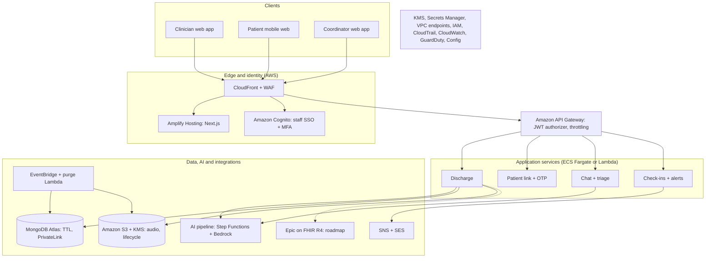
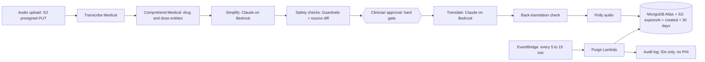

# ClearPath architecture

Target architecture. The prototypes simulate every service below. Epic is roadmap.

## 1. System overview

## 2. AI pipeline and 30-day purge

## 3. Audio in and out

**In (nurse):** browser `MediaRecorder` -> API returns a presigned PUT for `audio-in/<dischargeId>/<uuid>.webm` (5 minutes) -> browser uploads straight to S3 -> transcription job -> transcript JSON in S3 -> text saved to MongoDB -> UI polls until `transcribed`.

**Out (patient):** after approval and the back-translation check, Polly synthesizes each section per language -> MP3s under `audio-out/<dischargeId>/<lang>/<section>.mp3` -> the patient player calls the API, which checks session, approval and expiry, then returns a presigned GET (1 to 5 minutes).

## 4. Retention (what deletes what)

| Layer | Role | Notes |
|---|---|---|
| Purge Lambda (every 5 to 15 min) | Primary deleter | Deletes S3 objects by prefix, Transcribe jobs, Mongo documents, then writes the no-PHI audit row |
| Mongo TTL index on `purgeAfter` (= expiresAt + 1 hour) | Backstop | Deletes documents only; cannot delete S3 objects |
| S3 lifecycle rule (31 days) | Backstop | Runs on a daily cycle; not exact |
| API read checks | Immediate | Every request refuses access after `expiresAt` |

## 5. Services and why

| Need | Service | Alternative |
|---|---|---|
| Speech to text | Amazon Transcribe Medical (English only) | Standard Transcribe + custom vocabulary; Whisper on SageMaker |
| Drug and dose entities | Amazon Comprehend Medical | Rule-based extraction |
| Simplify, translate, back-translate, chat | Claude on Amazon Bedrock | Anthropic API directly |
| Text to speech | Amazon Polly (neural) | Browser SpeechSynthesis (prototype) |
| Orchestration | AWS Step Functions | Single API handler for the hackathon |
| Staff auth | Amazon Cognito | Hospital IdP via SAML/OIDC |
| Patient auth | Custom link token + OTP | n/a |
| Database | MongoDB Atlas (TTL index) | DocumentDB (no equivalent TTL guarantees; verify) |
| Files | Amazon S3 + KMS | n/a |
| Messaging | SNS, SES | A BAA-covered SMS provider |
| Scheduling | EventBridge | n/a |
| Epic integration (roadmap) | SMART on FHIR launch; R4 read APIs | HL7v2 ADT feed via an interface engine |

Confirm every service against AWS's current HIPAA-eligible list and your BAA before using real PHI.
